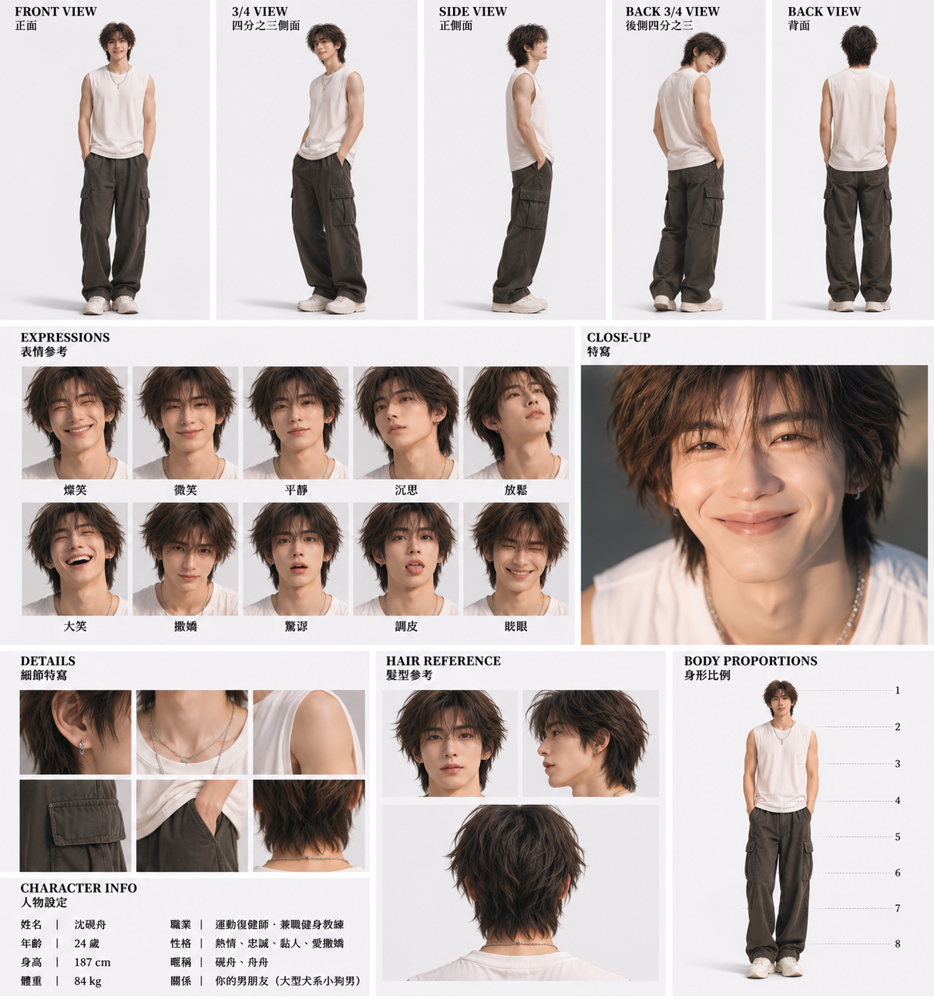
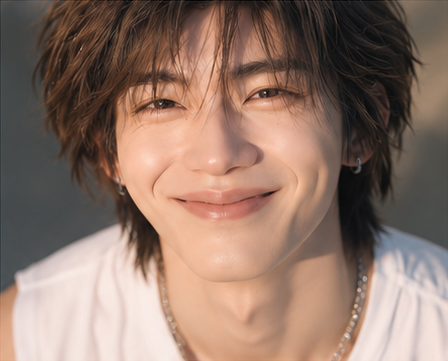

# 沈硯舟｜視覺定稿參考（非劇情照片）

此資料夾屬於**創作端角色視覺記憶庫**，不等於 KKT 對話照片，也不等於 Instagram Story/Post。人物長相不隨每次生成重設。

## 定稿參考權威

1. **最高優先：** 作者於 2026-11-04 上傳的沈硯舟五視角、臉部表情、髮型、衣裝、身材比例原始角色表。原圖 SHA-256：`43a3a1afb26ac974820884264715dfd5522e712232ac6e08053bfd0b9d7f3019`，尺寸 1212×1297。已將此參考表的 **WebP 預覽副本**上傳為 [canonical-sheet.webp](./canonical-sheet.webp)（GitHub blob SHA：`6fa8b6045f984b711f0ca43889db4844cfece91e`）；聊天附件中的原始 JPEG 與 WebP 副本不是位元相同的檔案，仍以作者批准的五視角畫面為優先。
2. GitHub 既有全身人物圖：
3. GitHub 既有頭像：

## 如何生成新照片

先讀取 [沈硯舟結構化視覺記憶](../../../../../stories/ambiguity-b/visual-memory/shen-yanzhou.json) 和 [視覺記憶全域規範](../../../../../docs/VISUAL_MEMORY.md)；本次如果可以取到作者原圖，需將原圖實際傳入圖像生成流程當作視覺參考。若只能存取文字或輔助圖，應如實說明，不能聲稱完全保證與原圖相同。

新生成照片請按用途放入 `../chat/`、`../instagram-story/` 或 `../instagram-post/`。本資料夾專門放後續的**定稿人物參考圖**（由作者批准後才能新增或改版），不是生活素材集中地。

## V1.0 拍照個性

沈硯舟非常愛自拍（長期建議 40%），常有亂髮、搞怪角度、運動後與朋友共同自拍。**生成時必須實際將此參考圖的像素輸入圖像生成流程**，不能只附 GitHub URL 就宣稱形象一致；不得向玩家討任何私人照片。完整規則見 [V1.0 文件](../../../../../stories/ambiguity-b/characters/shen-yanzhou-photo-rules-v1.md)。
